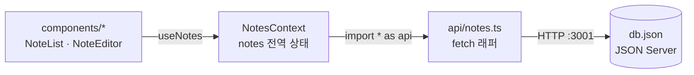
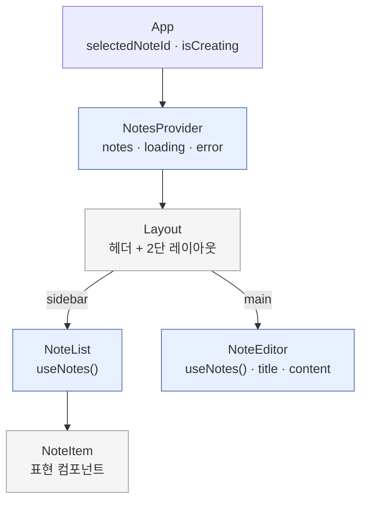
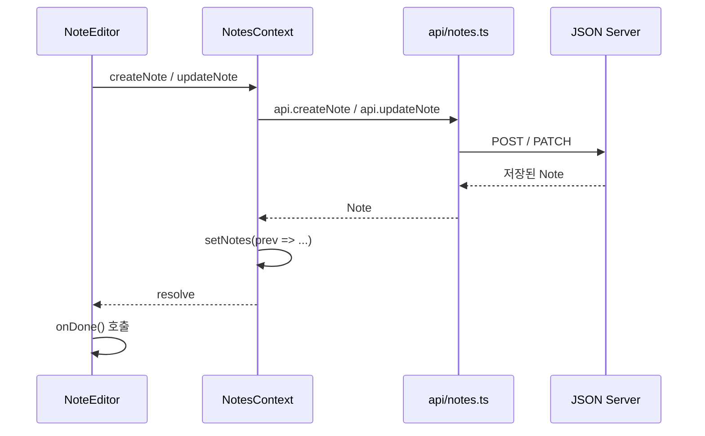

# Notes App

React 19 + TypeScript + Vite 기반 노트 앱 실습 프로젝트.

## 시작하기

```bash
# 저장소 클론
git clone git@github.com:frongt/ccwork.git
cd ccwork

# 의존성 설치
npm install

# 개발 서버 실행 (프론트 + JSON Server 동시 실행)
npm run dev
```

- 앱: http://localhost:5173
- API: http://localhost:3001/notes

## 스크립트

| 명령어 | 설명 |
|--------|------|
| `npm run dev` | 개발 서버 실행 |
| `npm run build` | 프로덕션 빌드 |
| `npm run lint` | ESLint 검사 |
| `npm run format` | Prettier 포맷 |
| `npm test` | 테스트 실행 |

## 프로젝트 구조

```
src/
├── api/          # JSON Server API 호출
├── components/   # UI 컴포넌트
├── context/      # React Context (전역 상태)
└── types/        # TypeScript 타입 정의
```

## 아키텍처

### 데이터 흐름

컴포넌트는 `api/notes.ts`를 직접 호출하지 않고 항상 `useNotes()`를 거친다.



### 컴포넌트 트리

`App`이 UI 상태(`selectedNoteId`, `isCreating`)를 소유하고 props로 내려준다. 서버 데이터는 `NotesContext`가 소유한다.



파란색은 `useNotes()`로 데이터를 아는 컴포넌트, 회색은 props만 받는 표현 컴포넌트다.

### 저장 시퀀스

변경 함수는 API 호출이 성공한 뒤에만 로컬 state를 갱신한다(낙관적 업데이트 없음).


